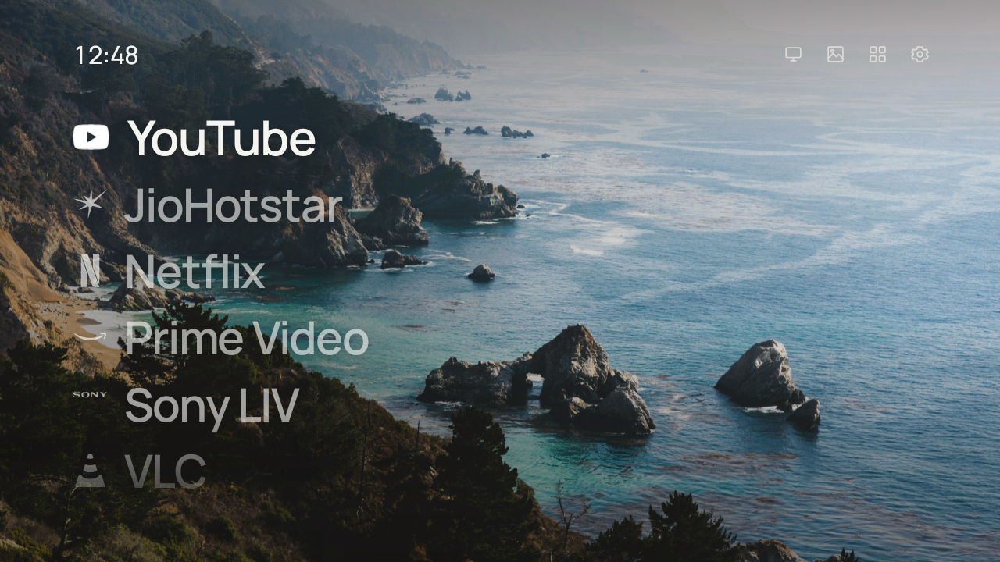

# Android TV cleanup + Frame Home

Make a slow, ad-filled Android TV quick and calm again: switch off the bloatware over adb, then
replace the stock home screen with **Frame Home**, a small native launcher modelled on
[CleanFrame](https://github.com/nthnclrk/CleanFrame).



Frame Home shows a full-screen photo, a clock, your apps as a large type list, and four quiet icons:
Inputs, Wallpaper, All apps and Settings. There are no ads, recommendation rows or sponsored tiles.

> **Tested on one TV only:** a Toshiba Android TV running Android 11 (MediaTek chipset, 1 GB RAM,
> 1280×720 UI). Other TVs may behave differently. Everything here can be undone, but read
> [Risks and undo](#risks-and-undo) before you start.

## Contents

- [What's in this repo](#whats-in-this-repo)
- [Part 1: Clean up the TV](#part-1-clean-up-the-tv)
- [Part 2: Install Frame Home](#part-2-install-frame-home)
- [Using Frame Home](#using-frame-home)
- [Customising](#customising)
- [How Frame Home works](#how-frame-home-works)
- [Troubleshooting](#troubleshooting)
- [Risks and undo](#risks-and-undo)
- [Credits and licences](#credits-and-licences)

## What's in this repo

| Path | What it is |
| --- | --- |
| `framehome/` | Frame Home launcher source (plain Java, no Gradle or AndroidX) |
| `framehome/build.ps1` | Builds and signs `FrameHome.apk` using the Android SDK command-line tools |
| `framehome/deploy.ps1` | Installs the APK over Wi-Fi adb, in chunks that survive a flaky connection |
| `apply_changes.ps1` | The cleanup as it was run on the tested TV. Disables apps and writes the log and undo script |
| `undo_all.ps1` | Generated by `apply_changes.ps1`. Reverts every change in one command |
| `tv_changes_log.txt` | Timestamped record of every change made |
| `meminfo_*.txt`, `packages_*.txt` | Before/after memory snapshots and the package audit from the tested TV |

## Part 1: Clean up the TV

### Requirements

- A Windows PC on the same network as the TV. The scripts are PowerShell, but every step is a plain
  `adb` command you can run on macOS or Linux.
- adb: `winget install Google.PlatformTools` (macOS: `brew install android-platform-tools`,
  Linux: `sudo apt install adb`).
- On the TV, Developer options turned on (Settings → Device Preferences → About → press **Build** 7
  times), then **USB debugging** turned on.

### 1. Connect

```powershell
adb connect <tv-ip>:5555     # then press "Allow" on the TV and tick "Always allow"
adb devices                  # should list the TV as "device"
```

If you don't know the TV's IP address, check Settings → Network on the TV, or scan your subnet for
port 5555.

### 2. Audit before you change anything

```powershell
adb shell cat /proc/meminfo > meminfo_before.txt
adb shell pm list packages -f -u > packages_all.txt
```

Sort the packages into three groups: **required** (system, launcher, Play Store, keyboard, TV
inputs, remote/Bluetooth), **yours** (apps you use), and **safe to disable** (preinstalled
extras, ad and recommendation services, demo and factory-test apps). Here is what was disabled on
the tested TV:

| Package | What it is |
| --- | --- |
| `com.google.android.tvrecommendations` | Feeds the recommendation and sponsored rows |
| `android.autoinstalls.config.*` | Play Auto Installs: silently pushes OEM apps |
| `com.google.android.play.games` | Play Games |
| `com.google.android.feedback` | Google feedback reporter |
| `com.google.android.syncadapters.calendar` | Calendar sync (there's no calendar on a TV) |
| `com.android.printspooler`, `com.android.htmlviewer` | Printing and an HTML file viewer |
| `fusion.android.tv.demo`, `com.cvte.tv.fac.aging` | Store demo mode and factory burn-in test |
| `com.google.android.apps.mediashell` | Chromecast built-in (only if you don't cast) |
| `com.google.android.tvlauncher` | Stock home screen (only after another launcher is the default) |
| Unused streaming apps | Whatever you don't watch |

### 3. Apply

Only ever **disable** apps. Never uninstall system apps.

```powershell
adb shell pm disable-user --user 0 <package>     # undo: adb shell pm enable <package>
```

For snappier menus, set the animation scales to 0. The defaults are usually 1, 1 and 0.6, but
note your own first.

```powershell
adb shell settings put global window_animation_scale 0
adb shell settings put global transition_animation_scale 0
adb shell settings put global animator_duration_scale 0
```

`apply_changes.ps1` does all of this in one go, logging each change and writing `undo_all.ps1`.
It holds the package list and device address from the tested TV, so edit both before you run it.

### 4. Reboot properly

> [!IMPORTANT]
> Don't use `adb reboot` straight after disabling apps. It can restart the TV before Android has
> saved the new package states, and then every disable is silently undone. Wait about 30 seconds,
> then reboot through Android:
>
> ```powershell
> adb shell svc power reboot
> ```

After the reboot, check that the disables stuck (`adb shell pm list packages -d`) and compare
memory against your baseline.

**Result on the tested TV** (free memory at idle after a reboot):

| | MemAvailable |
| --- | --- |
| Before | 291 MB |
| Cleanup + FLauncher | 346 MB |
| Cleanup + Frame Home | 360 MB |

Each value is a single reading, so expect some variation between boots.

## Part 2: Install Frame Home

### Requirements

- Android SDK with **build-tools 36.0.0** and **platform android-35**. Installing Android Studio
  gets you both, plus a JDK.
- A JDK 17 or newer. Android Studio's bundled `jbr` is used if `JAVA_HOME` isn't set.
- No Gradle is needed.

### Build

```powershell
powershell -ExecutionPolicy Bypass -File framehome\build.ps1
```

This compiles the resources with `aapt2`, compiles the Java with `javac`, converts it with `d8`,
then aligns and signs the APK, producing `framehome\FrameHome.apk`. The first build creates a
signing key, `framehome\framehome.jks`. Keep it: later builds must use the same key to install
over the old one. It's in `.gitignore`, so don't commit it.

The script reads `ANDROID_HOME` and `JAVA_HOME` when they're set. Otherwise it uses the default
Android Studio locations.

### Install

```powershell
powershell -ExecutionPolicy Bypass -File framehome\deploy.ps1 -Device <tv-ip>:5555
adb shell cmd package set-home-activity local.framehome/.HomeActivity
```

`deploy.ps1` sends the APK in 256 KB pieces, retries any that fail, checks the reassembled file's
checksum, and then installs it on the TV. A plain `adb install` also works if your TV's Wi-Fi
holds up for large transfers.

Once Frame Home is the default, you can disable the stock launcher so it can't take over again:

```powershell
adb shell pm disable-user --user 0 com.google.android.tvlauncher
```

## Using Frame Home

| On the remote | What it does |
| --- | --- |
| Up / Down | Move through your apps |
| OK | Open the app |
| Hold OK, or Menu | Move the app up or down, or remove it from Home |
| Up from the first app, or Right | Reach the top-right icons |
| Home | Go back to the top of the list |

The top-right icons, from left to right:

- **Inputs** opens the TV's input picker for HDMI sources (`com.android.tv.action.VIEW_INPUTS`).
- **Wallpaper** switches to the next photo. Your choice is remembered.
- **All apps** lists every installed app. OK opens one, and holding OK adds it to or removes it
  from Home.
- **Settings** opens Android TV settings.

## Customising

**Default apps:** on first run, Home shows the packages in `DEFAULT` in
[`Apps.java`](framehome/src/local/framehome/Apps.java). After that, the list is whatever you
arrange on the TV.

**Your own wallpaper:** push a JPEG, then press the Wallpaper icon until it appears. A custom
photo comes first in the cycle.

```powershell
adb push photo.jpg /sdcard/Android/data/local.framehome/files/wallpaper.jpg
```

**Bundled wallpapers:** add a `wp_<name>.jpg` to `framehome/assets/` and its name to `BUILT_IN`
in [`Wallpapers.java`](framehome/src/local/framehome/Wallpapers.java). Keep asset files at the top
level of `assets/`. On Windows, `aapt2` stores subfolder paths with backslashes, and Android then
can't find them.

**App marks:** Netflix, YouTube, Prime Video and VLC use bundled white marks from Simple Icons.
For any other app, Frame Home builds a mark from the app's own launcher icon (see
[`Marks.java`](framehome/src/local/framehome/Marks.java)). This works well for white logos on a
coloured tile, such as JioHotstar's star. It works less well when the logo itself is coloured:
SonyLIV comes out as just the word "SONY". To use a proper mark for an app, add a vector to
`res/drawable/` and map the package in `Apps.mark()`.

## How Frame Home works

| File | Role |
| --- | --- |
| `Stage.java` | CleanFrame lays out on a 1920×1080 stage. This maps stage pixels to the TV's real pixels, and loads the Manrope font. |
| `HomeActivity.java` | The home screen: photo, clock, app list, utility icons and edit dialog |
| `ListPane.java` | The big-type list. Rows are 62% opaque, and the focused row is full and scaled to 1.05×. Edges are faded with a gradient mask, and the list scrolls only when it overflows. |
| `ShadeView.java` | CleanFrame's photo treatment: a left-to-right dim, a top shade, a column shade and a bottom scrim |
| `Wallpapers.java` | Decodes one wallpaper at screen width in RGB_565 (about 2 MB) and caches it |
| `Marks.java` | Bundled marks, or white marks extracted from launcher icons |
| `AllAppsActivity.java` | The All apps screen |

Design choices:

- **Plain Java and platform widgets only**, to keep memory low on a 1 GB TV. The launcher uses
  about 60 MB.
- **`targetSdkVersion 29`**, which avoids Android 11's package-visibility rules and the
  uncompressed-`resources.arsc` requirement. That lets the build add `classes.dex` with a plain
  `jar --update`.
- **Animation durations follow the system animator scale.** If you set it to 0 in Part 1, focus
  changes happen instantly.

## Troubleshooting

**`adb: device offline` partway through an install.** This TV's Wi-Fi adb drops long transfers.
Use `deploy.ps1`, or reconnect and retry:
`adb disconnect <ip>:5555; adb connect <ip>:5555`.

**The TV disappears from the network entirely.** It may be in standby with Wi-Fi off. Turn it fully
on, check it's on the right network, and confirm USB debugging is still enabled. Some firmware
turns it off after a power cycle.

**Disabled apps come back after a reboot.** Either the reboot was too quick (see
[Reboot properly](#4-reboot-properly)), or the firmware re-enables them. On the tested Toshiba,
`com.at.factory.factorymanager` re-enables **Chromecast** and **TV recommendations** on every boot.
Check the log for its `enableApp` lines:

```powershell
adb logcat -d | Select-String enableApp
```

**Home opens the old launcher.** Run `set-home-activity` again, or disable the other launcher.

## Risks and undo

Disabling system apps carries some risk. A wrong choice can break a feature, and on some TVs it can
cause a boot loop. That's why this repo only **disables** apps (never uninstalls) and logs every
change. If the TV won't boot, a factory reset re-enables everything.

Undo everything in one command:

```powershell
powershell -ExecutionPolicy Bypass -File undo_all.ps1
```

This re-enables every disabled app, restores the animation scales, makes the stock launcher the
home screen again, removes Frame Home, and reboots.

## Credits and licences

- **Design:** modelled on [CleanFrame](https://github.com/nthnclrk/CleanFrame) by Nathan Clark (MIT
  licence), a home screen for Samsung The Frame. Frame Home is an independent Android
  reimplementation with no affiliation.
- **Wallpapers:** from CleanFrame, under the [Unsplash License](https://unsplash.com/license).
  Misty coast by Ganapathy Kumar, Quiet cove by Joshua Wordel, Forest mist by Dejan Zakic,
  Mountain valley by Aniket Deole, Blue peaks by John Rodenn Castillo, and Desert stars by
  Mohammad Alizade.
- **Font:** [Manrope](https://github.com/sharanda/manrope), SIL Open Font License 1.1.
- **Brand marks:** [Simple Icons](https://simpleicons.org), CC0. The trademarks belong to their
  owners, and their use here implies no endorsement.
- **Utility icons:** outlines from CleanFrame (MIT). The Inputs icon was drawn to match.

The licence texts ship inside the app under `framehome/assets/LICENSE-*.txt`.
